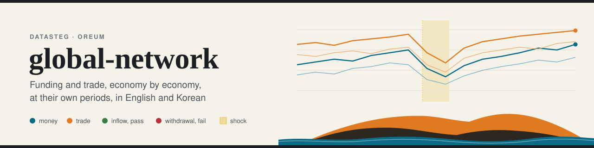
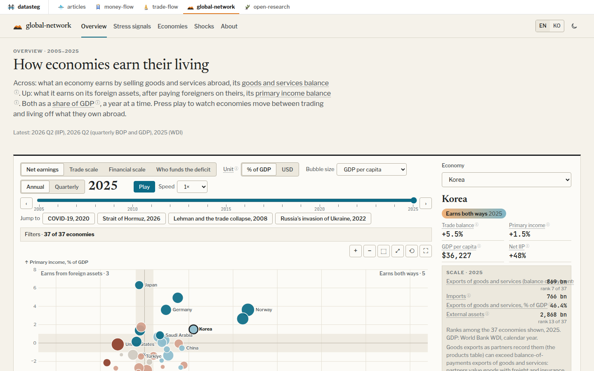
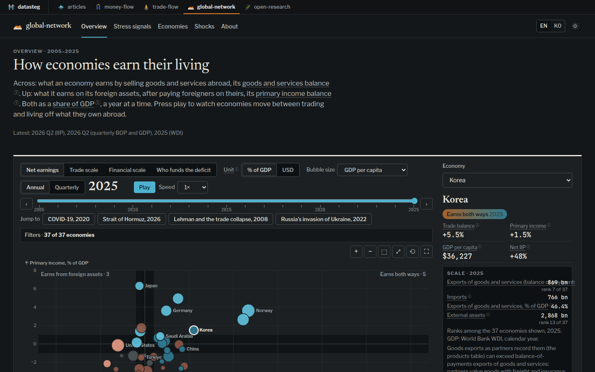

# Oreum

Oreum is global-network's design system. An *oreum* is one of the small volcanic cones that dot Jeju island, and the
whole palette comes from the island. The page is the sand of Hyeopjae beach by day and porous basalt by night. Money
is the sea off Seongsan and trade is Jeju tangerine. Grass on an oreum means good, the camellia means bad, and canola
yellow marks a highlight. The site's one idea, money and trade side by side, is carried by those two colours: every
panel belongs to the money lane or the trade lane and takes its tone.

The page is built like a Jeju stone wall: flat panels separated by thin lines, not floating cards. A panel shows its
lane only on its top rule (3px of sea or tangerine), and a stat tile only on its left rule.

Two files hold the system:

- [`design/tokens.css`](design/tokens.css): every colour, type stack, space, radius and size, for the **Morning**
  (light) and **Night** (dark) themes. Every colour on the site is one of these tokens.
- [`design/oreum.css`](design/oreum.css): the components, prefixed `gn-`, which use only tokens. Site-specific layout
  is in [`app/app/site.css`](app/app/site.css).

  
  

## Identity colours

| Token | Hex | From the island | Role |
|---|---|---|---|
| `--basalt` | `#1C1F21` | porous volcanic rock | ink by day, the page by night |
| `--sand` | `#F5F2EA` | Hyeopjae sand | the page by day |
| `--sea` | `#0B6B86` | the sea off Seongsan | **the money colour**; the action fill by day |
| `--sea-lit` | `#4FB3CF` | the same sea at dusk | money and actions by night |
| `--tangerine` | `#E07B22` | Jeju tangerine | **the trade colour** |
| `--oreum` | `#3E7A4A` | grass on an oreum | good, pass, inflow |
| `--camellia` | `#B5333B` | camellia in winter | bad, fail, withdrawal |
| `--canola` | `#E9C23A` | canola fields in spring | highlight, selected period, shock band |

## Role tokens in both themes

Components never use the identity colours directly. They use role tokens, which change between the themes. Night
applies when the reader's system prefers dark (`prefers-color-scheme`) or when the moon button in the masthead sets
`data-theme="dark"`. The choice is remembered in the browser.

| Token | Morning | Night | Used for |
|---|---|---|---|
| `--surface` | `#F5F2EA` | `#141719` | page |
| `--surface-raised` | `#FCFBF7` | `#1C2023` | panels, cards, inputs |
| `--surface-sunk` | `#ECE8DD` | `#0E1113` | notices, segmented controls, table hover |
| `--line` / `--line-strong` | `#D8D3C6` / `#B4AE9F` | `#2C3236` / `#434B50` | rules between panels; control borders |
| `--ink` / `--ink-2` / `--ink-3` | `#1C1F21` / `#4B5154` / `#6F7679` | `#E8E6DF` / `#B8BCB9` / `#8C9397` | text, secondary text, labels and kickers |
| `--accent` | `#0B6B86` | `#4FB3CF` | primary buttons, the current menu item, focus |
| `--link` | `#085A72` | `#7CC9DF` | links |
| `--money` / `--money-text` / `--money-soft` | `#0B6B86` / `#085A72` / `#DCEEF3` | `#4FB3CF` / `#7CC9DF` / `#10303A` | the money lane: rules, text on tags, tag grounds |
| `--trade` / `--trade-text` / `--trade-soft` | `#E07B22` / `#9A4E0C` / `#FBE8D6` | `#F09A4A` / `#F4B06E` / `#3A2410` | the trade lane |
| `--good` / `--good-soft` | `#3E7A4A` / `#DDEDE0` | `#7FC08C` / `#17301D` | pass, inflow |
| `--bad` / `--bad-soft` | `#B5333B` / `#F6DEDF` | `#F08086` / `#3A1518` | fail, withdrawal |
| `--warn` / `--warn-soft` | `#A8650C` / `#FAEFD0` | `#F0B860` / `#332810` | warn status, notice rule |
| `--highlight` | `#E9C23A` | `#F0D060` | the selected period |

## Chart colours

| Token | Morning | Night | Used for |
|---|---|---|---|
| `--viz-money` / `--viz-money-2` | `#0B6B86` / `#7FB5C6` | `#4FB3CF` / `#2F7A91` | a money series; its second series (B → A in a pair) |
| `--viz-trade` / `--viz-trade-2` | `#E07B22` / `#F0B27A` | `#F09A4A` / `#A3622A` | a trade series; its second series |
| `--viz-context` | `#C9C3B4` | `#3A4247` | context lines, economies outside the filter, surplus economies in the funding lens |
| `--viz-axis` / `--viz-grid` | `#B4AE9F` / `#E4DFD3` | `#434B50` / `#262C30` | axes and grid |
| `--viz-band` | canola at 22% | canola at 18% | episode and shock bands |
| `--viz-div-0` … `--viz-div-4` | `#8E3F2B` `#D4A08C` `#CFCAC0` `#8DBDCD` `#0B6B86` | `#E39A82` `#8C5747` `#4C5458` `#2F7A91` `#5FC0DA` | net international investment position: debtor clay, neutral sand-grey, creditor sea |

## Chart conventions

- **Money is sea, trade is tangerine, everywhere.** A line, a bar, a tile rule or a family card takes the colour of
  its lane. Two series of one lane use the full tone and its lighter `-2` tone. In a pair chart, A → B is full and
  B → A lighter.
- **Status colours are not data colours.** Oreum green and camellia red mean pass and fail, or inflow and
  withdrawal. The diverging scale for net IIP is clay to sea, so a debtor never looks like an error.
- **The funding lens** (who funds the deficit) uses a five-step sequential scale of the sea, mixed into the panel
  ground, for the creditor share. Economies in surplus are grey.
- **Shocks and episodes** are a canola band (`--viz-band`) with a dashed canola line at the start. The selected
  period uses `--highlight`.
- **Estimates are dashed**, and partner-reported or estimated trade is marked. A mirror band shows where the two
  partners' reports differ.
- **Every figure keeps its own period**, printed in the panel head in the figure face (`.gn-period`). Every chart
  ends with a source line (`.gn-source`): the publisher, the licence, the period, the read date and the parent site
  it came through.
- Lines are 1.75px with round joins; context lines are 1.25px. Axis text is 11px in the text face.

## Type

Oreum defines three stacks in `design/tokens.css`:

| Token | Stack | Role |
|---|---|---|
| `--font-display` | Hahmlet, Noto Serif KR, Georgia | headings, the wordmark, big stat values |
| `--font-sans` | IBM Plex Sans KR, IBM Plex Sans, Pretendard | text, menus, labels, chart text |
| `--font-mono` | Source Code Pro, Menlo, Consolas | periods, codes, formulas |

All figures use tabular numerals. Korean text uses `word-break: keep-all`, and kickers and table heads drop their
uppercase and wide tracking in Korean.

Since 9 November 2026, every datasteg site sets type the same way as www.datasteg.com. A shared type layer
([`app/lib/ds-type.css`](app/lib/ds-type.css), loaded by [`app/lib/ds-fonts.ts`](app/lib/ds-fonts.ts) after Oreum)
points these tokens at Newsreader for headings and numbers, Libre Franklin for text and JetBrains Mono for codes. Korean
falls back to Noto Serif KR and Pretendard. That is what the live site and the screenshots show. Components keep their
Oreum sizes and spacing; only the typeface changes. The Open Graph cards (`app/lib/og.tsx`) still draw in IBM Plex
Sans KR from `app/public/fonts`. All fonts are self-hosted under the SIL Open Font License.

## Components

All components live in `design/oreum.css`.

| Class | What it is |
|---|---|
| `.gn-masthead`, `.gn-nav`, `.gn-wordmark` | the header: the oreum mark and name, five sections, EN/KO switch, the theme button; a menu button on phones |
| `.gn-lane--money`, `.gn-lane--trade` | set `--tone`, `--tone-text` and `--tone-soft` for everything inside |
| `.gn-panel` | a flat raised panel with a 3px top rule in its lane's tone |
| `.gn-tiles`, `.gn-tile` | stat tiles: label, value in the display face, a sub-line coloured up or down, an optional sparkline |
| `.gn-table` | uppercase small heads, right-aligned tabular numbers, row hover in `--surface-sunk` |
| `.gn-seg`, `.gn-btn`, `.gn-select` | segmented controls, buttons (primary in `--accent`), selects at one control height (36px) |
| `.gn-tag` | small tags in the lane's soft ground, or good, bad, warn and neutral |
| `.gn-notice` | a sunk block with a warn (or accent) left rule, for caveats such as "observed data, not causal attribution" |
| `.gn-source` | the source line under every figure |
| `.gn-axis`, `.gn-grid`, `.gn-line-money`, `.gn-line-trade`, `.gn-episode` | chart primitives for SVG |
| `.gn-family` (site.css) | the footer strip of the datasteg flow sites; each card's top rule is its site's tone |

Spacing runs on a 4px base (`--space-1` 4px up to `--space-7` 48px). Radii are small (2, 4 and 6px, plus pills for
tabs). The text measure is 68 characters. Under `prefers-reduced-motion`, animation and transitions are turned off.
