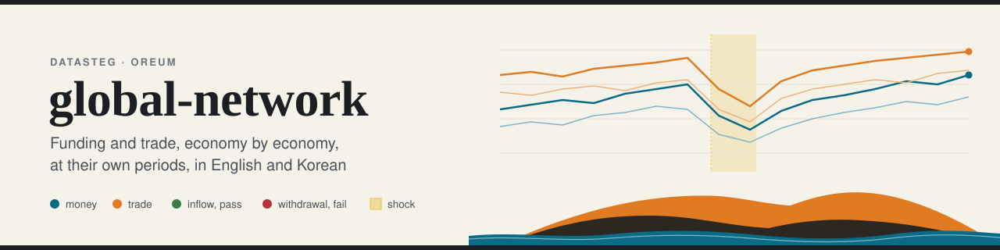
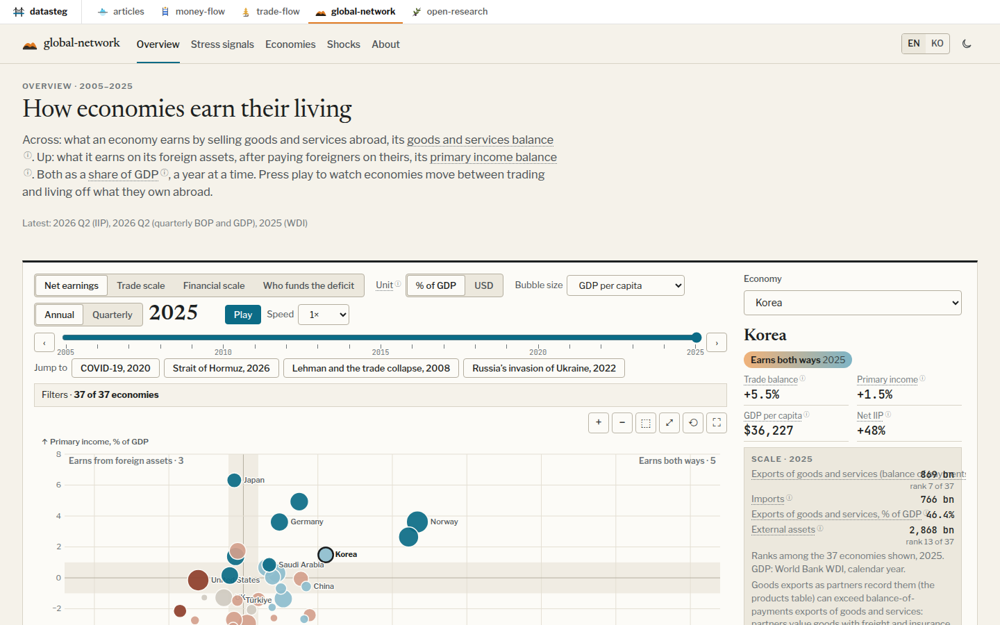
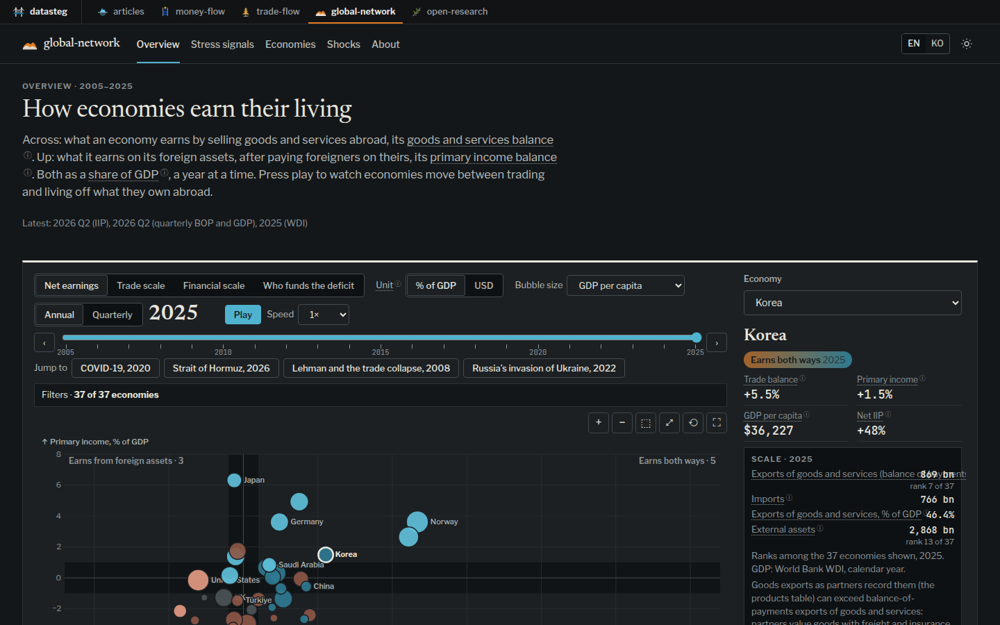
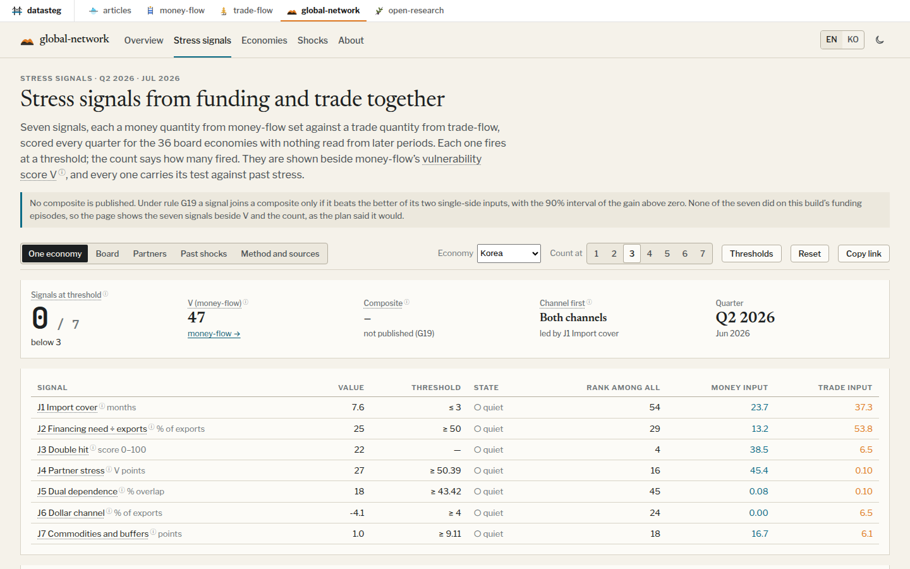
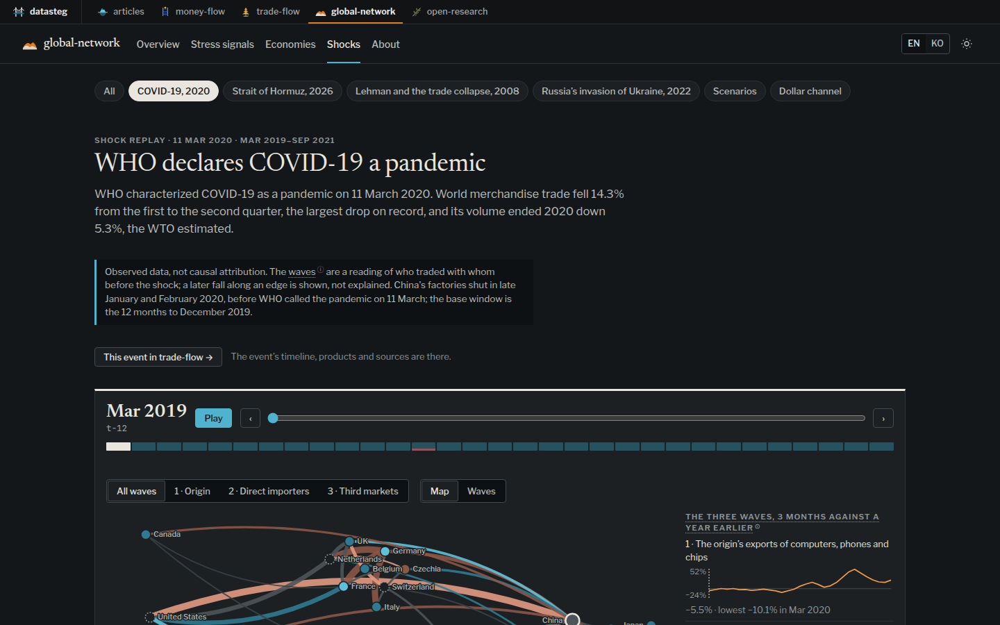
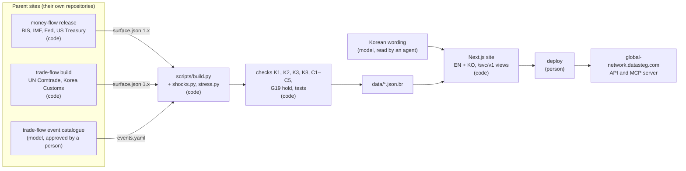
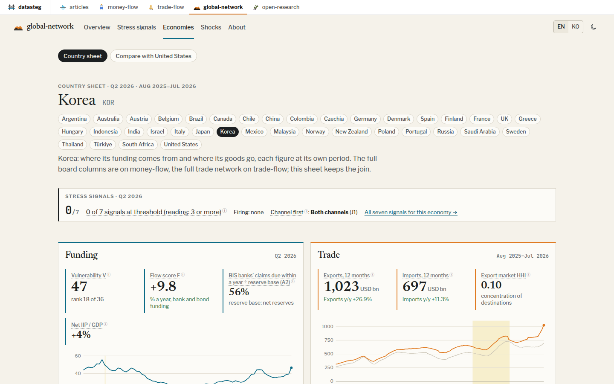

<p align="center"></p>

# global-network

**Funding and trade, economy by economy, on one screen.** global-network joins two other datasteg sites.
[money-flow](https://github.com/datasteg/money-flow) publishes cross-border money (BIS, IMF, the Federal Reserve, the
US Treasury). [trade-flow](https://github.com/datasteg/trade-flow) publishes goods trade (UN Comtrade, the Korea
Customs Service). global-network puts them side by side for 36 borrowing economies and the United States, keeps
every number at its own period (a quarter for funding, a 12-month window for trade) and publishes the result in
English and Korean.

It collects nothing itself. Every series arrives through the published surfaces of the two parent sites (rule G18 on
the About page), and every page footer names the two versions it was built from.

**Live site:** https://global-network.datasteg.com · **Part of:** https://www.datasteg.com ·
**API and MCP server:** https://www.datasteg.com/en/technology/api

<p align="center">
  
  
</p>

## What the site shows

| Page | What it shows |
|---|---|
| **Overview: how economies earn their living** (`/en`) | Trade balance across, primary income up, both as a share of GDP, a year or a quarter at a time from 2005. Press play to watch economies move between earning by trading and living off what they own abroad. Lenses for net earnings, trade scale, financial scale and *who funds the deficit*. Units are % of GDP or US dollars, with filters by region, group and size. |
| **Country sheets** (`/en/c/KOR`) | Funding on the left: money-flow's vulnerability score V, flow score F, short-term bank claims against reserves (A2), net reserves, net IIP and the largest bank lenders, all at the board quarter. Goods trade on the right: 12-month exports as partners record them, partners, HS chapters and the chokepoints the economy holds. The sheet also has a stress-signal strip and a replay of bank and bond withdrawals. |
| **Pairs** (`/en/c/KOR/with/USA`) | Goods, bank loans and deposits, portfolio holdings and direct investment between two economies, in both directions and each at its own period. The finance-to-trade ratio is drawn through time. |
| **Shock replays** (`/en/shocks`) | Lehman and the trade collapse (2008), COVID-19 (2020), Russia's invasion of Ukraine (2022) and the Strait of Hormuz (2026). Each replay runs month by month over the trade network in three waves: the origins, their direct importers and the third markets. Funding is shown by quarter beside it. This is observed data, not causal attribution. The section also has the dollar channel and first-round scenarios (a past withdrawal share applied to today's stock; arithmetic, never a forecast). |
| **Stress signals** (`/en/stress`) | Seven joint signals, J1 to J7. Each sets a money quantity against a trade quantity: import cover, financing need over exports, the double hit, partner stress, dual dependence, the dollar channel, and commodities against buffers. Each economy is scored every quarter using only data available at that quarter. The page shows how many signals reached their threshold, and every signal carries its test against past episodes of funding stress. |
| **Digest and What changed** | A short quarterly digest, and threshold crossings only: V crossing 60, F or export momentum changing sign, A2 passing 100%, a chokepoint moving. Joint moves come first, then the parents' own crossings. No trend is fitted. There is an RSS feed at `/feed`. |
| **About** | The rules (G1 to G20), the validation table (AUROC with bootstrap intervals), the checks of this build and the provenance of every input. |

### Why no composite stress score is published

The joint signals had to earn their place. Under **rule G19**, a signal can enter a published composite only if it
separates the quarters before an episode from calm quarters better than the better of its own two single-side inputs.
The gain must also hold up statistically: its 90% bootstrap interval must lie above zero. In the build documented in
[docs/methodology/stress-v1.0.md](docs/methodology/stress-v1.0.md), no signal passed. The strongest, J7, reached an
AUROC of 0.777, but its interval overlaps that of its money side alone. The count of signals scored 0.751 against 0.725
for V on the same sample, and the interval of that difference includes zero. So the page shows the seven signals beside
V and publishes no composite, and it says so. The check runs again on every build (`scripts/stress.py`,
`config/stress.yaml`).

<p align="center">
  
  
</p>

## From data to publication

Every step is marked by what happens when it runs. **Code** means plain code that calls no model (AI agents wrote
almost all of it, and a person reviewed it). **Model** means a model does the work on every run. **Person** means a
person approves or acts. The marks match the agent list at https://www.datasteg.com/en/technology/agents.



1. **The parents publish (code, in their own repositories).** money-flow cuts content-addressed releases from the
   statistics publishers. trade-flow builds 12-month and 3-month trade windows, product chains and its trade-event
   catalogue. That catalogue is the one model step upstream of this site: an AI agent writes it in a working session
   from publishers' own pages, and a person approves it. Each parent writes a versioned export surface
   (`surface.json`). [docs/SURFACES.md](docs/SURFACES.md) describes what global-network reads from each.
2. **The build joins them (code).** [`scripts/build.py`](scripts/build.py) reads the two surfaces and nothing else. It
   stops on a surface major version it was not written for, joins on the ISO alpha-3 code and writes one brotli JSON
   file per view under `data/`. [`scripts/shocks.py`](scripts/shocks.py) builds the replays from
   [`config/shocks.yaml`](config/shocks.yaml) and trade-flow's event dates.
   [`scripts/stress.py`](scripts/stress.py) scores the seven signals from [`config/stress.yaml`](config/stress.yaml),
   point in time, and validates them. [`scripts/inputs.py`](scripts/inputs.py) fingerprints the inputs so an
   unchanged build can be skipped. A person runs the build after a parent releases.
3. **Checks (code).** The build fails when a consistency check fails. K1 checks that growth compares windows exactly 12
   months apart. K2 checks that joined values equal the parents' own series. K3 checks that a quarter pairs only with
   the window ending in its last month (or one marked partial). K8 checks that every table read matches its hash and
   comes from the same parent build. The joint checks C1 to C5 pass or warn with their figures on the About page. The
   G19 hold decides whether any composite is shown. In [`tests/`](tests): `test_consistency.py` deliberately introduces
   a mismatch and checks that it is caught, `test_stress.py` holds hand checks and the no-look-ahead property, and
   `test_svc.py` runs the API views against a running server with a licence gate (no commercial vendor's name in any
   answer) and a size budget.
4. **Korean (model).** Every Korean string on the site comes from datasteg's Korean wording model, qkr, an open-weights
   model fine-tuned to the sites' style. An AI agent reads each answer before it is applied. Nobody writes Korean by
   hand, and a deploy gate refuses any Korean string that is not on record. A few strings of the shared measures
   registry were drafted with Claude and are marked so in the Korean ledger (not part of this snapshot).
5. **Publication (person).** A person deploys global-network. The container image carries the built data, and a
   deploy counts only when the live `/health` names the exact build just made. The same views are served to the
   datasteg API and MCP server through `app/app/svc/v1` and [`api.yaml`](api.yaml): one economy, one pair, one shock,
   the stress board.

<p align="center"></p>

## Repository map

```
app/                      the Next.js site (App Router, standalone output)
  app/[lang]/             pages: Overview, stress, c/[code] (country sheet), c/[code]/with/[b] (pair),
                          shocks (hub, [id] replays, dollar, scenarios), digest, changes, about
  app/svc/v1/             the views behind the datasteg API and MCP server (one per page, page parity)
  app/feed/, sitemap.ts   RSS feed and sitemap; health/ names the data build
  components/             charts (earn/, stress/, ShockReplay, PairSeries), masthead, footer, glossary cards
  lib/                    data readers (data.ts), EN and KO strings (strings/), glossary, sources and citations,
                          the shared site family (family.json) and measures registry (measures.json)
design/                   Oreum: tokens.css (colours, type, spacing; Morning and Night) and oreum.css (components)
scripts/                  build.py (the join), shocks.py (replays), stress.py (signals), inputs.py (fingerprint)
config/                   shocks.yaml (replays), stress.yaml (signals, thresholds, expectations), regions.yaml
tests/                    test_consistency.py, test_stress.py, test_svc.py
docs/                     SURFACES.md (the inputs from the two parents), methodology/stress-v1.0.md
api.yaml                  this app's views for the datasteg API and MCP server
Dockerfile                the image: Next.js standalone server, Oreum and the built data, non-root
```

A few paths in the code point outside this repository, to the shared datasteg tree: `../trade-flow` (the parent's
data and event list), `family/` (the shared site family, type and measures registry, copied into `app/lib/`) and
`api/` (the API service that calls `/svc/v1`).

## Oreum, the design system

Oreum takes its palette from Jeju island. The page is Hyeopjae sand by day and basalt by night. Money is the sea off
Seongsan and trade is tangerine. Oreum green means good and camellia red means bad, and canola yellow marks a selected
period or a shock. Panels are flat, like a stone wall: separated by lines, not floating cards. Every colour on the
site is a token in [`design/tokens.css`](design/tokens.css). See [DESIGN.md](DESIGN.md) for the palette, the type,
the two themes and the chart conventions.

## About this repository

This is a **read-only snapshot** of the code behind the live site, published to show how AI agents carry public data
to a checked, bilingual site. It is not set up to run on its own. The build reads money-flow's and trade-flow's
published surfaces, which are not included, and the repository holds no data, raw or built. datasteg publishes
derived results only and does not redistribute source data. For the numbers, use
[the site](https://global-network.datasteg.com) or the [API and MCP server](https://www.datasteg.com/en/technology/api).
Each figure there carries its source, licence, period and read date.

Related repositories: [money-flow](https://github.com/datasteg/money-flow) and
[trade-flow](https://github.com/datasteg/trade-flow), the two parents.

© datasteg. All rights reserved.
